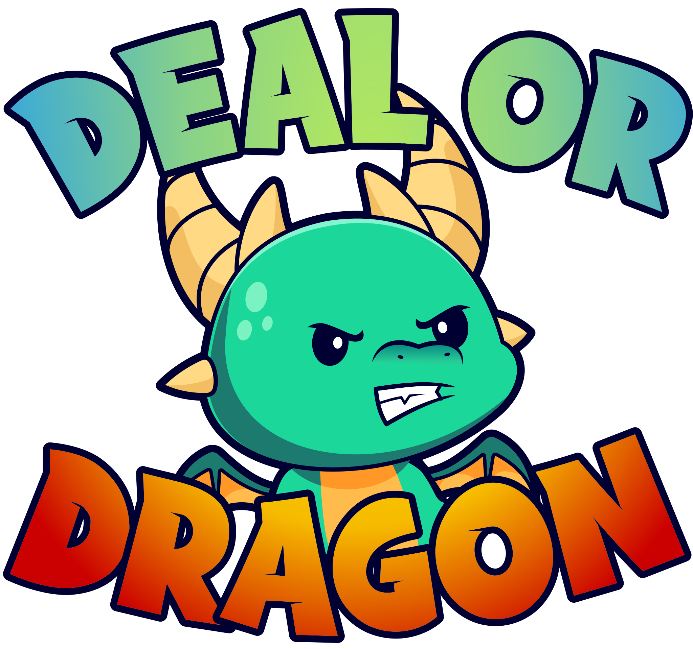
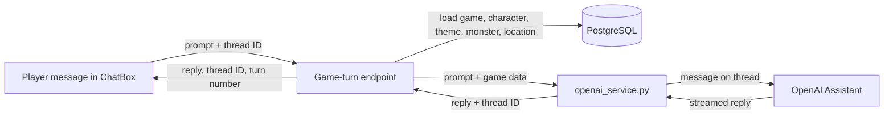

<p align="center">
  
</p>

# Deal or Dragon

**Deal or Dragon** is a dungeon crawler with a twist: instead of fighting the monster, you try to talk it into buying something. Each monster is an AI character that stays in role, remembers the conversation and responds to your character's stats.

I built this with four teammates as a coding bootcamp group project in August and September 2024. I worked mainly on the backend game logic and on connecting the game to the AI chat.

> **Project status: archived, and the AI chat no longer works.** The chat was built on the OpenAI Assistants API, which [OpenAI shut down on August 26, 2026](https://developers.openai.com/api/docs/deprecations). Accounts, character creation and the game setup code don't depend on that API, but monster conversations need a migration to the Responses and Conversations APIs.

## Why this repository exists

This is a cleaned portfolio copy of the team's original repository, which remains private. It starts with a fresh git history, so **the commit graph here doesn't show who wrote what**. The section below describes my work instead.

I made a new repository rather than sharing the original for two reasons:

- **The old history contained things that shouldn't be public.** That included a Django development secret key, teammates' personal email addresses and machine-specific file paths. Git keeps deleted files, so removing them from the latest version wouldn't have been enough.
- **It held thousands of files that didn't belong in source control.** These included two Python virtual environments, `node_modules`, compiled Python files and a full copy of the repository itself, left behind by an earlier attempt to scrub the history.

Starting fresh was simpler and safer than trying to rewrite 235 commits and hoping nothing was missed. I also didn't want to filter the history down to my own commits, because that would misrepresent a team project as solo work.

**What changed from the team's final code:**

- **Removed:** dependencies, OS and editor files, test images saved by the app, unused scripts and the default Vite README.
- **Added:** this README, an `.env.example` file and extra `.gitignore` rules.
- **Not changed:** the application code that remains is exactly as the team left it, including its rough edges.

## What I built

I made 53 of the 223 commits on the original `main` branch: 34 code commits and 19 merges, between August 28 and September 10, 2024.

| Dates (2024) | What I added |
|---|---|
| Aug 28–29 | Built `game_app` from scratch (models, serializers, URLs and views) and resolved the conflicts when merging it with `character_app`. Added the custom user manager behind email-based login. |
| Aug 30–31 | Built the endpoints for creating, fetching and deleting a game. Replaced the placeholder AI prompt data with live game data. |
| Sep 1–3 | **Got conversation memory working** (details below). Added a shared logging configuration, moved old code out of the service and switched the game endpoints to look up games by ID. Built the game-turn endpoint, incorporating Erika's code. |
| Sep 5–6 | Split the game data into separate `Theme`, `Monster` and `Location` models. Added a post-migration step that fills in the game's starting content. Connected the models to game and character creation in the frontend. |
| Sep 6–8 | Built the chat page and connected `ChatBox` to the backend with Erika. Added the prompt rules that shaped how monsters behave, which Erika later refined. |
| Sep 9–10 | Fixed a bug that blocked access to turn data by separating it from game data. Made turn counts start at zero and reset correctly. Refined the monster descriptions and goals. |
| Throughout | Did much of the branch integration, including pull requests #19 and #28. |

### Getting the monsters to remember

Erika wrote the first version of `openai_service.py`, including the code that creates and reuses OpenAI conversation threads. However, the thread ID never made it back to the rest of the app, so nothing could continue an earlier conversation.

I completed that loop:

1. The service returns the thread ID along with the AI's response.
2. The game-turn endpoint sends that ID to the browser.
3. `ChatBox` stores the ID and sends it back with the player's next message.
4. The ID is also saved on the `Game` record.

I got there in stages. An early version required pasting the thread ID in by hand, as a commit from that day admits.

### What the team built

Erika also built the win/loss logic, which asks the monster for a yes or no decision from turn 3 and ends the game at turn 10. My teammates wrote most of the interface, character creation and account code.

## How a turn works



## Features

- **Accounts:** sign up with an email address and track wins and losses.
- **Custom characters:** design an avatar and allocate strength, intelligence and charisma points that affect how monsters treat you.
- **Three settings:** sell a sword to a dragon, a fan to a cyborg, or a pen to a ruthless stock trader.
- **AI conversations:** each monster stays in character and remembers what you've said.

## Built with

React and Vite, Django and Django REST Framework, PostgreSQL, the OpenAI Assistants API (now shut down) and Mailchimp.

## Running it locally

You'll need Python, Node.js and PostgreSQL. **The monster chat won't work until it's migrated off the Assistants API.**

**Backend**

```bash
cd backend
python -m venv venv
source venv/bin/activate
pip install -r requirements.txt

cd chatbot_proj
cp .env.example .env              # then fill in your own values
createdb your_database_name       # use the same name as DATABASE_NAME in .env
python manage.py makemigrations   # migration files aren't committed
python manage.py migrate          # also adds the game's starting content
python manage.py runserver
```

New signups are sent to the Mailchimp audience set in `.env`.

**Frontend**

```bash
cd frontend/chatbot
npm install
npm run dev
```

The frontend expects the backend at `http://127.0.0.1:8000`.

**What's been tested:** in November 2026, on Python 3.12 and Node 18, the dependencies installed, Django's system check passed, migrations and starting content worked against a temporary SQLite database, and the frontend built for production. The full app hasn't been run end to end on PostgreSQL since the Assistants API shut down.

## What I'd do differently

- **Keep secrets and dependencies out from day one.** Set up `.gitignore` and environment variables before the first commit, because cleaning them up later is far harder.
- **Merge smaller changes more often.** Many of my commits were spent resolving conflicts between long-running branches.
- **Commit migrations.** They were ignored here, which made it harder for everyone's databases to stay in step.
- **Replace debug logging with tests.** The chat flow was mostly checked through log output, including one line that logged the OpenAI API key until I removed it. Automated tests would have been safer.
- **Keep third-party AI behind a small interface.** That would make the move off the Assistants API a contained change.

## Team

- [Len Kedrow](https://github.com/Len-Kedrow)
- [Kyle Bleeker](https://github.com/ksbleek)
- [Brandon Yeoh](https://github.com/byeoh100)
- [Erika Holzinger](https://github.com/iamAtomika)
- [Christopher Roberts](https://github.com/ChrisRoberts13)
